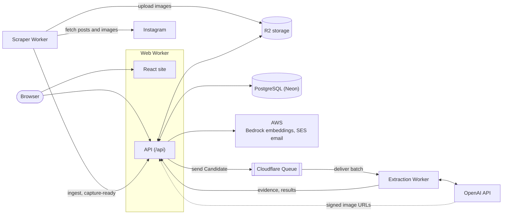

# UBC Discovery

UBC Discovery is a student-built event discovery product for the UBC community. It helps people find what is happening around campus without making sign-up the first step.

This project is a continuation of **UBC-Newcomers**. The original idea focused on helping transfer, international, and first-year students feel less lost when arriving at UBC. That newcomer problem is still the starting wedge, but the product has expanded into a broader public discovery experience for Campus Explorers across the UBC community.

UBC Discovery is independent and is not an official UBC app.

## Core Concepts

### Event Listings

Event Listings are public, shareable pointers to campus or club events. They usually include an organizer, source link, human-readable location text, date, and vibe. Location text is the source of truth for where an event occurs.

Sources use clear labels:

- **UBC Official** for UBC, faculty, department, or official university events.
- **AMS Club** for AMS-recognized club and student society events.
- **Campus Community** for relevant community-sourced or manually reviewed campus happenings.

### Personalized Discovery

Members can select fixed Interests during onboarding and edit them later. Interests power the Personalized Event Feed alongside Event Listing vibes, saved events, ratings, timing, and academic context.

Interests describe what a Member wants to explore. Vibes describe the feel or intent of an Event Listing.

## App Areas

- **Discover**: primary event discovery surface for public browsing and personalized feeds.
- **Event Details**: shareable Event Listing pages that open directly on web.
- **Saved**: member-only saved Event Listings.
- **Profile**: member profile, interests, UBC verification, and settings.

## How It Works

UBC Discovery is a web app at [ubcdiscovery.com](https://ubcdiscovery.com). It runs on Cloudflare Workers, stores data in PostgreSQL, and gathers club events from public posts that are extracted with AI and then published automatically or reviewed by an administrator. Recommendations compare events by their content and vibes.

The scraper runs twice a day. Each new post becomes a Candidate: the API sends it to the Queue, the extraction Worker asks OpenAI to extract event details, and the API saves the result and publishes it or holds it for review. See [Queue extraction](docs/operations/queue-extraction.md) for the details.

## Contributing

See [`AGENTS.md`](AGENTS.md) to set up the project and start working on it. Domain vocabulary lives in [`CONTEXT.md`](CONTEXT.md).
